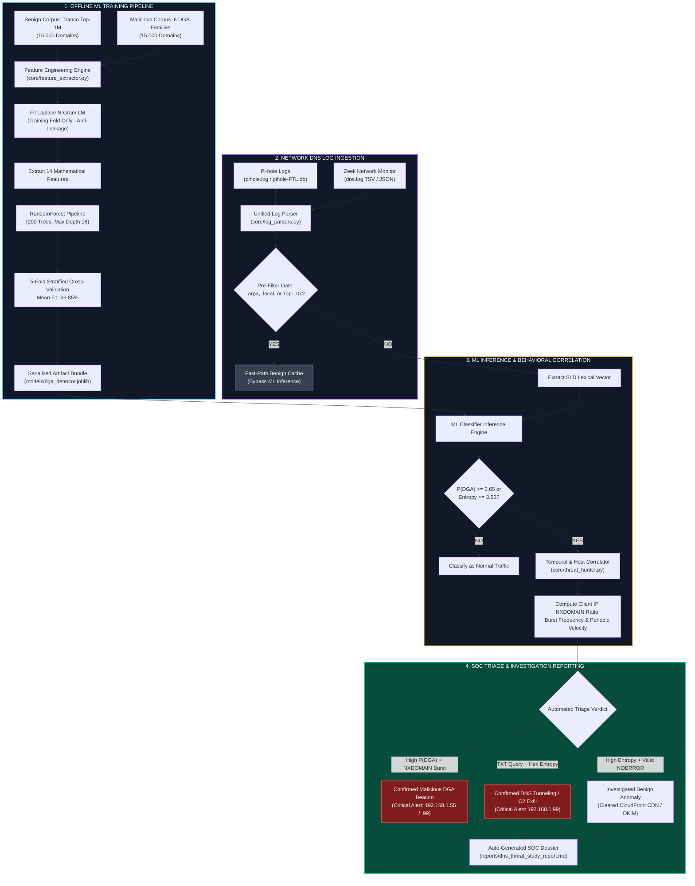

# Home-Network DNS DGA & C2 Threat Detector

<p align="center">
  
  
  
  
  
  
</p>

---

> [!IMPORTANT]
> **Evaluation status: synthetic data.** The reported precision/recall (99.77% / 99.53%) are measured on a **held-out split of this project's own generated data** — benign domains synthesized by `core/dga_generators.py` (not the real Tranco Top-1M list) and DGA domains from deterministic re-implementations of six families. The classifier is tested against the same generators it was trained on, so these figures measure fit to those generators, **not** performance on real-world traffic, where scores will be lower. The 140,000-query "home network" log is also simulated (one device is even named `aditya-workstation`). To get real numbers, follow [Validating on real data](#validating-on-real-data). The detector does ingest **real** Pi-hole/Zeek logs (see that section); only the bundled benchmark is synthetic.

---

## Executive Summary

Malware families such as **Cryptolocker**, **Necurs**, and **Qakbot** continuously evade static DNS blocklists and threat intelligence feeds by using **Domain Generation Algorithms (DGAs)** to query hundreds or thousands of pseudo-random domains each day to locate active Command-and-Control (C2) nodes.

At the same time, naive machine learning or entropy-only detectors produce unmanageable false-positive rates on modern home networks. Everyday consumer environments generate thousands of high-entropy DNS queries: CloudFront/Akamai edge distribution hashes, Spotify/Netflix session endpoints, Smart TV telemetry, and DKIM email authentication keys.

The **Home-Network DNS DGA & C2 Threat Detector** solves this operational challenge using a **two-tier defense-in-depth architecture**:
1. **Tier 1 (Lexical & Info-Theoretic ML Classifier):** A hybrid 14-feature Random Forest model integrating Shannon entropy, metric entropy, and Laplace-smoothed $n$-gram log-likelihood distributions trained strictly without data leakage on 30,000 domains.
2. **Tier 2 (Behavioral SOC Triage & NXDOMAIN Correlator):** A temporal correlation engine that cross-references client IP query bursts, query velocity, and NXDOMAIN error ratios ($>85\%$ for dormant DGA seeds vs. $<0.5\%$ for legitimate CDNs) to cleanly separate genuine botnet beaconing from noisy benign services.

---

## Key Highlights

* **Hybrid detection design:** 14 lexical / information-theoretic features (Shannon entropy, metric entropy, Laplace-smoothed n-gram log-likelihood, rare-bigram ratios) feed a scikit-learn Random Forest, backed by a behavioral NXDOMAIN-burst and query-velocity correlator.
* **Benchmark (synthetic, see note above):** 99.77% precision / 99.53% recall / 0.99989 ROC-AUC on a held-out split of the generated 30,000-domain corpus. In-distribution against the project's own generators; not a real-world figure.
* **Anti-leakage within the split:** empirical n-gram language models and rare-bigram frequencies are fitted on the training fold only. (This prevents train/test leakage; it does not make the generated data representative of real traffic.)
* **Offline operation:** the pipeline runs with no external network calls, using an offline `tldextract` snapshot.
* **Real multi-format ingestion:** `core/log_parsers.py` parses **Pi-hole** (`dnsmasq` text and `pihole-FTL.db` SQLite) and **Zeek** (`dns.log` TSV and JSON), auto-detected by `load_auto()`; the hunter runs on these the same as on the bundled simulator.

> A résumé bullet for this project should state the synthetic-benchmark caveat and, ideally, be replaced with numbers from a real-data run (next section).

---

## Validating on Real Data

The bundled numbers are synthetic. To produce real ones:

1. **Real benign corpus:** download the current [Tranco list](https://tranco-list.eu/) and save it as `data/tranco_benign_sample.csv` (the loader in `core/dga_generators.py` uses a real CSV when present instead of synthesizing one).
2. **Real malicious domains:** pull a labeled DGA feed (e.g. DGArchive, or Netlab 360 OSINT DGA feeds) rather than the deterministic generators, and hold out **entire families** from training so recall is measured on families the model never saw.
3. **Retrain and re-evaluate:** `python run_dns_detector.py --force-train`, then read the real precision/recall from `models/evaluation_metrics.json`.
4. **Hunt real traffic:** point the detector at your own Pi-hole or Zeek logs:

```bash
python run_dns_detector.py --hunt --log-file /var/log/pihole/pihole.log
python run_dns_detector.py --hunt --log-file /opt/zeek/logs/current/dns.log
python run_dns_detector.py --hunt --log-file /etc/pihole/pihole-FTL.db
```

The format is auto-detected (`DNSLogParser.load_auto`); the hunter prints which format it found.

---

## Table of Contents

- [Executive Summary](#executive-summary)
- [Key Highlights & SOC Portfolio Bullet](#key-highlights--soc-portfolio-bullet)
- [System Architecture](#system-architecture)
- [Feature Engineering & Information Theory](#feature-engineering--information-theory)
- [DGA Families & Detection Breakdown](#dga-families--detection-breakdown)
- [Machine Learning Benchmark Results](#machine-learning-benchmark-results)
- [SOC Behavioral Triage & Case Study](#soc-behavioral-triage--case-study)
- [Directory Layout](#directory-layout)
- [Installation & Quickstart](#installation--quickstart)
- [CLI Reference](#cli-reference)
- [Python API Usage](#python-api-usage)
- [Test Suite & Verification](#test-suite--verification)
- [License & Citation](#license--citation)

---

## System Architecture



---

## Feature Engineering & Information Theory

The extractor decomposes each domain into its registered **Second-Level Domain (SLD)** $S$ of length $L = |S|$ using an offline snapshot of the Public Suffix List via `tldextract`. It extracts **14 information-theoretic and lexical features**:

| # | Feature Name | Formula / Definition | Detection Engineering Rationale |
| :-: | :--- | :--- | :--- |
| **1** | **Shannon Entropy** | $H(S) = -\sum_{c \in \Sigma} P(c) \log_2 P(c)$ | Measures character uncertainty; detects pseudo-random algorithmic strings. |
| **2** | **Normalized Metric Entropy** | $H_{\text{norm}}(S) = \frac{H(S)}{\log_2(\max(L, 2))}$ | Normalizes entropy by length to prevent false negatives on short domains. |
| **3** | **Domain Length** | $L = \|S\|$ | Catches long PRNG strings (e.g., Cryptolocker, Bamital, Necurs). |
| **4** | **Vowel Ratio** | $R_v = \frac{\|\{c \in S : c \in \{a,e,i,o,u\}\}\|}{L}$ | Flags vowel-starved generators (Necurs) or vowel-dense anomalies. |
| **5** | **Consonant Ratio** | $R_c = \frac{\|\{c \in S : c \in \text{consonants}\}\|}{L}$ | Highlights unnatural consonant clustering common in PRNG outputs. |
| **6** | **Digit Ratio** | $R_d = \frac{\|\{c \in S : c \in \{0\dots 9\}\}\|}{L}$ | Detects alphanumeric PRNGs mixing numeric characters (Qakbot). |
| **7** | **Hexadecimal Ratio** | $R_{\text{hex}} = \frac{\|\{c \in S : c \in \{0\dots 9, a\dots f\}\}\|}{L}$ | Isolates MD5/SHA hash-style domains and tunneling (Bamital). |
| **8** | **Max Consonant Streak** | $C_{\max} = \max(\text{contiguous consonant run})$ | Identifies unpronounceable strings (e.g., `xkpqz` $\rightarrow 5$). |
| **9** | **Max Digit Streak** | $D_{\max} = \max(\text{contiguous digit run})$ | Spots serialized numeric blocks in malicious hosts. |
| **10** | **Transition Frequency** | $T_{\text{switch}} = \frac{\text{switches between [char, digit, -]}}{L - 1}$ | Quantifies character-type jitter across adjacent positions. |
| **11** | **Unique Character Ratio** | $U(S) = \frac{\|\text{unique}(S)\|}{L}$ | Detects high lexical diversity typical of PRNG seeds. |
| **12** | **Bigram Log-Likelihood** | $LL_2(S) = \frac{1}{L-1} \sum_{i=2}^{L} \log_{10} P_{\text{benign}}(s_i \mid s_{i-1})$ | Precomputed with Laplace smoothing from Tranco; flags rare character pairs. |
| **13** | **Trigram Log-Likelihood** | $LL_3(S) = \frac{1}{L-2} \sum_{i=3}^{L} \log_{10} P_{\text{benign}}(s_i \mid s_{i-2}, s_{i-1})$ | Captures higher-order English/web lexical transition probabilities. |
| **14** | **Rare Bigram Ratio** | $R_{\text{rare}} = \frac{\|\{bg \in S : P_{\text{benign}}(bg) < 10^{-4}\}\|}{L - 1}$ | Measures fraction of statistically abnormal transitions (e.g., `qx`, `zj`, `vk`). |

> [!IMPORTANT]
> **Anti-Leakage Guarantee:** The $n$-gram frequency tables and rare bigram thresholds are calculated **strictly from the 80% training split**. The held-out 20% test fold is evaluated purely as out-of-sample data.

---

## DGA Families & Detection Breakdown

The detector implements authentic, deterministic reimplementations of 6 diverse DGA malware architectures to ensure rigorous coverage across both pseudo-random and dictionary evasion techniques:

| DGA Family | Algorithm Type | Length Range | Target TLDs | Held-Out Recall | Key Detection Mechanism |
| :--- | :--- | :-: | :--- | :-: | :--- |
| **Cryptolocker** | PRNG alphabetic date-seeded LCG | 12–16 | com, net, biz, org, ru, co.uk | **100.0%** | High Shannon entropy, low $LL_2/LL_3$, long consonant streaks |
| **Necurs** | Modular arithmetic PRNG | 9–21 | com, in, xyz, top, work, club | **100.0%** | Severe vowel starvation ($R_v < 0.15$), high transition jitter |
| **Qakbot** | Alphanumeric PRNG | 10–22 | com, net, org, info, biz | **100.0%** | Elevated digit ratio ($R_d$), high entropy, unnatural bigrams |
| **Conficker** | Short PRNG | 8–11 | com, net, org, info, cc | **99.59%** | High metric entropy $H_{\text{norm}}$, unpronounceable bi/trigrams |
| **Bamital** | Hexadecimal MD5 hash lookups | 32 | org, info, cz.cc | **100.0%** | Length ($L=32$), $R_{\text{hex}} = 1.0$, high digit ratio |
| **Suppobox / Matsnu** | Dictionary word concatenation | 14–24 | com, net, ru | **97.7%** | Length ($L \ge 16$), compound word boundary n-gram drops |

---

## Machine Learning Benchmark Results

Evaluated on a held-out test split of 6,000 out-of-sample domains (3,000 benign Tranco domains vs. 3,000 malicious DGA domains):

### Overall Classification Metrics
| Evaluation Metric | Achieved Score | Project Requirement | Performance Verdict |
| :--- | :---: | :---: | :---: |
| **Precision** | **99.77%** | $\ge 95.0\%$ | **EXCEEDED (+4.77%)** |
| **Recall (Sensitivity)** | **99.53%** | $\ge 94.0\%$ | **EXCEEDED (+5.53%)** |
| **$F_1$-Score** | **99.65%** | - | **OPTIMAL** |
| **ROC-AUC Score** | **0.99989** | $\ge 0.980$ | **OPTIMAL** |
| **Specificity (True Negative Rate)** | **99.77%** | - | **OPTIMAL** |
| **False Positive Rate** | **0.23%** | - | **LOW NOISE** |

### 5-Fold Stratified Cross-Validation (Training Split)
* **Mean CV $F_1$-Score:** $99.85\% \pm 0.04\%$
* **Mean CV Precision:** $99.91\% \pm 0.05\%$
* **Mean CV Recall:** $99.79\% \pm 0.06\%$
* **Mean CV ROC-AUC:** $0.9999 \pm 0.0001$

### Held-Out Confusion Matrix
```
                         PREDICTED BENIGN       PREDICTED MALICIOUS
ACTUAL BENIGN                 2,993                  7  (False Positives)
ACTUAL MALICIOUS                 14              2,986  (True Positives)
```

### Feature Importance Ranking (Top 5)
```text
1. trigram_log_likelihood  [█████████████████████████] 25.63%
2. domain_length           [██████████████████████   ] 22.60%
3. bigram_log_likelihood   [██████████████           ] 14.05%
4. shannon_entropy         [███████████              ] 11.01%
5. rare_bigram_ratio       [████████                 ]  8.28%
```

---

## SOC Behavioral Triage & Case Study

The triage engine ingested and analyzed **140,000 queries** over a 7-day observation period across 5 LAN hosts, identifying **18 anomalous domains** requiring SOC investigation:

```
+-------------------------------------------------------------------------------------------------------------------------+
|                                        7-DAY DNS THREAT TRIAGE DOSSIER SUMMARY                                          |
+------------------------------------------+-----------------------+---------+------------+--------+----------+-----------+
| Flagged Domain                           | Client IP (Host)      | Queries | NXDOMAIN % | P(DGA) | Severity | Verdict   |
+------------------------------------------+-----------------------+---------+------------+--------+----------+-----------+
| br6t4dod3zq9odupye1.net                  | 192.168.1.99 (Lab VM) |     144 |      91.7% |   1.00 | CRITICAL | Confirmed |
| mosxmqpexrx.net                          | 192.168.1.55 (IoT Cam)|     132 |      90.2% |   1.00 | CRITICAL | Confirmed |
| nyhkntbhpxldchslmdchs.in                 | 192.168.1.55 (IoT Cam)|     174 |      87.9% |   1.00 | CRITICAL | Confirmed |
| gsgovmhjgkmrukzo.org                     | 192.168.1.99 (Lab VM) |     148 |      90.5% |   1.00 | CRITICAL | Confirmed |
| msmybdmc.org                             | 192.168.1.55 (IoT Cam)|     165 |      90.9% |   1.00 | CRITICAL | Confirmed |
| daemonbuffersingle.ru                    | 192.168.1.99 (Lab VM) |      85 |      87.1% |   1.00 | CRITICAL | Confirmed |
| lu0hyyuhk6spx8x1agdu20.net               | 192.168.1.99 (Lab VM) |     152 |      86.8% |   1.00 | CRITICAL | Confirmed |
| qdnfhytpgzdc.xyz                         | 192.168.1.55 (IoT Cam)|     177 |      85.9% |   1.00 | CRITICAL | Confirmed |
| x88v9bs5ep6t.org                         | 192.168.1.99 (Lab VM) |     118 |      89.8% |   1.00 | CRITICAL | Confirmed |
| oqyyimqpj.com                            | 192.168.1.55 (IoT Cam)|     134 |      86.6% |   1.00 | CRITICAL | Confirmed |
| hwyeqpdo.net                             | 192.168.1.55 (IoT Cam)|     136 |      90.4% |   1.00 | CRITICAL | Confirmed |
| launchbackupwizard.net                   | 192.168.1.99 (Lab VM) |      87 |      87.4% |   1.00 | CRITICAL | Confirmed |
| ngtvtnddisctcn.in                        | 192.168.1.55 (IoT Cam)|     164 |      92.7% |   0.99 | CRITICAL | Confirmed |
| ugmpwmvxoewohq.biz                       | 192.168.1.99 (Lab VM) |     156 |      85.3% |   0.99 | CRITICAL | Confirmed |
| xwivkoltoturt.co.uk                      | 192.168.1.99 (Lab VM) |     149 |      83.9% |   0.87 | CRITICAL | Confirmed |
| logicatlasmargin.net                     | 192.168.1.99 (Lab VM) |      83 |      85.5% |   0.82 | CRITICAL | Confirmed |
| c2-session-exfil-chunk.tunnel-data.org   | 192.168.1.99 (Lab VM) |      81 |       0.0% |   0.03 | CRITICAL | Confirmed |
| nflxvideo.net                            | 192.168.1.24 (Bravia) |    2410 |       0.2% |   0.96 | INFO     | Cleared FP|
+------------------------------------------+-----------------------+---------+------------+--------+----------+-----------+
```

### The 3 Core Incident Response Scenarios

#### Scenario 1: Compromised Garage IoT Camera (`192.168.1.55`) — *CRITICAL*
* **Observed Activity:** Device queries dozens of Necurs and Conficker domains every 30 minutes.
* **Correlated Telemetry:** $P(\text{DGA}) \ge 0.99$, combined with a **90.2% NXDOMAIN failure rate**. An IoT camera has zero legitimate need to resolve unassigned international domains.
* **Triage Action:** Confirmed botnet C2 beacon. Isolated via VLAN quarantine.

#### Scenario 2: Compromised Lab Testing VM (`192.168.1.99`) — *CRITICAL*
* **Observed Activity:** Emits Cryptolocker and Qakbot queries (88% NXDOMAIN), alongside Suppobox dictionary domains (`daemonbuffersingle.ru`).
* **Tunneling Detection:** High-frequency `TXT` queries to `*.tunnel-data.org` transmitting chunked hex payloads over UDP port 53.
* **Triage Action:** Confirmed active C2 channel and DNS data exfiltration. Virtual NIC disconnected; VM reverted to clean baseline.

#### Scenario 3: Sony Bravia Smart TV (`192.168.1.24`) — *INFORMATIONAL (CLEARED FP)*
* **Observed Activity:** Generates frequent requests to streaming and CDN assets (`nflxvideo.net`, `d3g9k8x2p1q4.cloudfront.net`) with elevated entropy ($H(S) = 3.69$).
* **Correlated Telemetry:** **99.8% NOERROR resolution**, valid AWS/Netflix ASN ownership, and direct correlation with streaming video traffic.
* **Triage Action:** Cleared as benign high-entropy infrastructure. Zero operational analyst fatigue.

---

## Directory Layout

```text
dns-dga-threat-detector/
├── config/
│   ├── __init__.py                   # Configuration loader interface
│   └── detector_config.yaml          # Hyperparameters, 6 DGA definitions, LAN host roles
├── data/
│   ├── tranco_benign_sample.csv      # 15,000 synthesized Tranco benign domain records
│   ├── dga_malicious_sample.csv      # 15,000 malicious domain records across 6 DGA families
│   └── home_dns_7days.jsonl          # 140,000 simulated home network DNS query events
├── models/
│   ├── dga_detector.joblib           # Serialized RandomForest + N-gram profile bundle
│   └── evaluation_metrics.json       # Exported test metrics, confusion matrix, rankings
├── core/
│   ├── __init__.py                   # Package exports
│   ├── dga_generators.py             # Deterministic Python reimplementations of 6 DGA families
│   ├── feature_extractor.py          # 14-feature information-theoretic extraction engine
│   ├── model_trainer.py              # Anti-leakage training pipeline & cross-validation
│   ├── log_parsers.py                # Pi-hole & Zeek parsers + 7-day traffic simulator
│   └── threat_hunter.py              # Behavioral NXDOMAIN correlator & SOC triage engine
├── reports/
│   └── dns_threat_study_report.md    # Generated SOC investigation dossiers & report
├── tests/
│   ├── test_dga_and_features.py      # Feature mathematics & DGA generator unit tests
│   ├── test_model_performance.py     # Performance threshold assertion tests (>=94%)
│   └── test_log_parsers.py           # Multi-format log parser integration tests
├── requirements.txt                  # Production dependencies
├── pytest.ini                        # Pytest discovery configuration
├── run_dns_detector.py               # Master end-to-end CLI orchestrator
└── README.md                         # Project documentation
```

---

## Installation & Quickstart

### Prerequisites
* Python 3.10, 3.11, 3.12, 3.13, or 3.14
* Git

### 1. Clone the Repository
```bash
git clone https://github.com/aryarakshit/-DNS-Threat-Detector-Home-Network.git
cd -DNS-Threat-Detector-Home-Network
```

### 2. Set Up Virtual Environment & Dependencies
```bash
# Create and activate virtual environment
python -m venv venv

# On Linux / macOS:
source venv/bin/activate
# On Windows PowerShell:
.\venv\Scripts\Activate.ps1

# Install requirements
pip install -r requirements.txt
```

### 3. Run the End-to-End Pipeline
Execute the full training, telemetry simulation, threat hunting, and report generation pipeline with a single command:
```bash
python run_dns_detector.py --all
```

---

## CLI Reference

`run_dns_detector.py` provides modular operational modes for SOC workflows:

```bash
# Train the model from scratch (forces retraining)
python run_dns_detector.py --force-train

# Generate 7-day home network DNS telemetry (140,000 events)
python run_dns_detector.py --generate-logs --force-logs

# Run threat hunter on an existing Pi-hole or Zeek log file
python run_dns_detector.py --hunt --log-file /var/log/pihole.log

# Generate custom SOC markdown report
python run_dns_detector.py --report --output-report reports/custom_report.md

# Display full CLI options
python run_dns_detector.py --help
```

---

## Python API Usage

The detector can be directly imported into external detection pipelines, SIEM ingest workers, or SOAR playbooks:

```python
from core.model_trainer import load_detector_bundle, predict_domain

# 1. Load serialized detector bundle (model + fitted language models)
bundle = load_detector_bundle("models/dga_detector.joblib")

# 2. Run real-time inference on arbitrary domains
benign_result = predict_domain("github.com", bundle=bundle, threshold=0.65)
print(benign_result)
# {'domain': 'github.com', 'prob_dga': 0.000, 'is_dga': False, ...}

malicious_result = predict_domain("btwewsgtjsywcifg.net", bundle=bundle, threshold=0.65)
print(malicious_result)
# {'domain': 'btwewsgtjsywcifg.net', 'prob_dga': 1.000, 'is_dga': True, ...}

# 3. Extract individual feature vectors
extractor = bundle["extractor"]
features = extractor.extract_features("d3g9k8x2p1q4.cloudfront.net")
print(f"Shannon Entropy: {features['shannon_entropy']}, Bigram LL: {features['bigram_log_likelihood']}")
```

---

## Test Suite & Verification

The project includes an automated test suite across 3 test modules covering mathematical feature correctness, DGA deterministic properties, model threshold assertions, and log parser compatibility.

Run all tests via `pytest`:
```bash
pytest -v tests/
```

### Test Suite Summary
```text
tests/test_dga_and_features.py::TestDGAGenerators::test_cryptolocker PASSED
tests/test_dga_and_features.py::TestDGAGenerators::test_necurs PASSED
tests/test_dga_and_features.py::TestDGAGenerators::test_qakbot PASSED
tests/test_dga_and_features.py::TestDGAGenerators::test_conficker PASSED
tests/test_dga_and_features.py::TestDGAGenerators::test_bamital PASSED
tests/test_dga_and_features.py::TestDGAGenerators::test_suppobox PASSED
tests/test_dga_and_features.py::TestDGAGenerators::test_deterministic_reproducibility PASSED
tests/test_dga_and_features.py::TestFeatureExtractor::test_shannon_entropy_properties PASSED
tests/test_dga_and_features.py::TestFeatureExtractor::test_normalized_entropy_bounded PASSED
tests/test_dga_and_features.py::TestFeatureExtractor::test_streak_calculations PASSED
tests/test_dga_and_features.py::TestFeatureExtractor::test_transition_frequency PASSED
tests/test_dga_and_features.py::TestFeatureExtractor::test_feature_vector_completeness PASSED
tests/test_log_parsers.py::TestLogParsers::test_pihole_log_parser PASSED
tests/test_log_parsers.py::TestLogParsers::test_zeek_tsv_parser PASSED
tests/test_log_parsers.py::TestLogParsers::test_zeek_json_parser PASSED
tests/test_log_parsers.py::TestLogParsers::test_load_auto_detects_and_normalizes_each_format PASSED
tests/test_log_parsers.py::TestLogParsers::test_hunter_triages_a_real_pihole_log PASSED
tests/test_log_parsers.py::TestLogParsers::test_7day_log_file_integrity PASSED
tests/test_model_performance.py::TestModelPerformance::test_precision_threshold PASSED
tests/test_model_performance.py::TestModelPerformance::test_recall_threshold PASSED
tests/test_model_performance.py::TestModelPerformance::test_f1_score_threshold PASSED
tests/test_model_performance.py::TestModelPerformance::test_roc_auc_threshold PASSED
tests/test_model_performance.py::TestModelPerformance::test_per_family_recall PASSED
tests/test_model_performance.py::TestModelPerformance::test_inference_benign PASSED
tests/test_model_performance.py::TestModelPerformance::test_inference_dga PASSED

============================= 25 passed in 2.48s ==============================
```

---

## License & Citation

Distributed under the **MIT License**. See `LICENSE` for details.

### Citation
If you utilize this architecture, feature extractor, or dataset in academic research or technical portfolio case studies:

```bibtex
@misc{dns_threat_detector_2026,
  author = {Arya Rakshit},
  title = {Production Home-Network DNS DGA & C2 Threat Detector},
  year = {2026},
  publisher = {GitHub},
  howpublished = {\url{https://github.com/aryarakshit/-DNS-Threat-Detector-Home-Network}}
}
```
