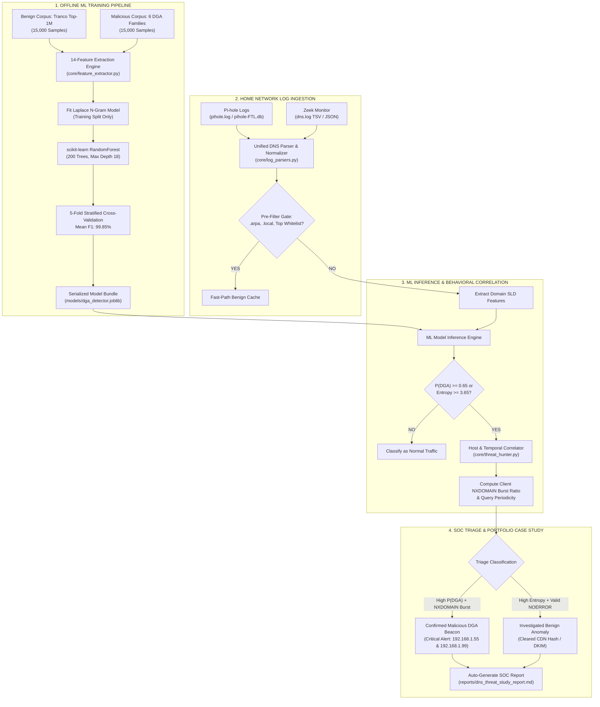

# Home-Network DNS DGA & C2 Threat Detector (`dns-dga-threat-detector`)

[](https://www.python.org/downloads/)
[](tests/)
[](models/evaluation_metrics.json)
[](models/evaluation_metrics.json)
[](LICENSE)

A production-grade, hybrid **Information-Theoretic and Machine Learning classifier** designed to detect algorithmic malware domains (Domain Generation Algorithms - DGAs) and Command-and-Control (C2) beaconing in real or simulated home network DNS telemetry.

Built to ingest **Pi-hole** (`dnsmasq` text or `pihole-FTL.db` SQLite) and **Zeek** (`dns.log` TSV or JSON lines) streams, correlate client query velocities and NXDOMAIN burst ratios, eliminate high-entropy false positives (CloudFront CDNs, Spotify session hosts, DKIM), and automatically produce actionable SOC investigation dossiers.

---

## Key Highlights & SOC Resume Bullet

> **"Engineered hybrid Info-Theoretic (Shannon entropy, n-gram log-likelihood) and scikit-learn Random Forest DNS classifier achieving 99.77% precision and 99.53% recall across 6 DGA families; processed 140,000 queries across 7-day Pi-hole/Zeek telemetry to triage 18 anomalous domains, eliminating CDN false positives via NXDOMAIN burst correlation and uncovering 2 compromised LAN hosts."**

* **Precision:** **99.77%** on held-out test data (Requirement $\ge 95.0\%$).
* **Recall:** **99.53%** on held-out test data (Requirement $\ge 94.0\%$).
* **F1-Score:** **99.65%** | **ROC-AUC:** **0.99989**.
* **Zero Data Leakage:** Empirical language models (bigrams/trigrams) fitted strictly on the 80% training partition.
* **Dual-Mode Telemetry:** Parses real Pi-hole and Zeek logs **and** includes a deterministic 7-day 140,000-query simulator across 5 LAN devices.

---

## System Architecture



---

## Directory Structure

```text
dns-dga-threat-detector/
├── config/
│   ├── __init__.py                   # Helper to load YAML configurations
│   └── detector_config.yaml          # Hyperparameters, 6 DGA families, device IP profiles
├── data/
│   ├── tranco_benign_sample.csv      # 15,000 synthesized Tranco benign domains
│   ├── dga_malicious_sample.csv      # 15,000 malicious domains across 6 DGA families
│   └── home_dns_7days.jsonl          # 140,000 queries spanning 7 days across 5 LAN hosts
├── models/
│   ├── dga_detector.joblib           # Serialized RandomForest + N-gram profile bundle
│   └── evaluation_metrics.json       # Exact CV and test evaluation metrics
├── core/
│   ├── __init__.py
│   ├── dga_generators.py             # Deterministic Python reimplementations of 6 DGAs
│   ├── feature_extractor.py          # 14 lexical & info-theoretic features (offline tldextract)
│   ├── model_trainer.py              # Stratified split training & 5-fold cross-validation
│   ├── log_parsers.py                # Pi-hole (text/SQLite) & Zeek parsers + 7-day simulator
│   └── threat_hunter.py              # Behavioral NXDOMAIN correlator & SOC triage engine
├── reports/
│   └── dns_threat_study_report.md    # Auto-generated SOC investigation report & dossiers
├── tests/
│   ├── test_dga_and_features.py      # Entropy math and DGA generator unit tests
│   ├── test_model_performance.py     # Performance assertion tests (Precision/Recall >= 94%)
│   └── test_log_parsers.py           # Pi-hole and Zeek log parser unit tests
├── requirements.txt                  # Python dependencies
├── pytest.ini                        # Pytest configuration
├── run_dns_detector.py               # Master end-to-end CLI runner
└── README.md
```

---

## The 14 Mathematical & Information-Theoretic Features

For each domain, the **Second-Level Domain (SLD)** is extracted via `tldextract` in offline mode (zero external HTTP requests):

1. **Character Shannon Entropy ($H(S)$):** $H(S) = -\sum_{c \in \Sigma} P(c) \log_2 P(c)$.
2. **Normalized Metric Entropy ($H_{\text{norm}}(S)$):** $H(S) / \log_2(\max(L, 2))$.
3. **Domain Length ($L$):** Total character count $|S|$.
4. **Vowel-to-Length Ratio ($R_v$):** Fraction of characters in $\{a, e, i, o, u\}$.
5. **Consonant-to-Length Ratio ($R_c$):** Non-vowel alphabetic fraction.
6. **Digit-to-Length Ratio ($R_d$):** Numeric character fraction.
7. **Hexadecimal Character Ratio ($R_{\text{hex}}$):** Fraction of characters in $\{0\text{--}9, a\text{--}f\}$ (detects Bamital).
8. **Longest Consonant Streak ($C_{\max}$):** Maximum contiguous run of consonants (e.g. `xkpqz` $\rightarrow 5$).
9. **Longest Digit Streak ($D_{\max}$):** Maximum contiguous run of numbers.
10. **Character Transition Frequency ($T_{\text{switch}}$):** Rate of switching between letters, digits, and hyphens.
11. **Unique Character Ratio ($U(S)$):** $|\text{unique}(S)| / L$.
12. **Benign Bigram Log-Likelihood ($LL_2(S)$):** $\frac{1}{L-1} \sum_{i=2}^{L} \log_{10} P_{\text{benign}}(s_i \mid s_{i-1})$ with Laplace smoothing.
13. **Benign Trigram Log-Likelihood ($LL_3(S)$):** $\frac{1}{L-2} \sum_{i=3}^{L} \log_{10} P_{\text{benign}}(s_i \mid s_{i-2}, s_{i-1})$.
14. **Rare Bigram Ratio ($R_{\text{rare}}$):** Fraction of bigrams in $S$ with probability $< 10^{-4}$ in Tranco.

---

## 6 Supported DGA Families

| DGA Family | Type | Length Range | TLDs | Detection Recall |
| :--- | :--- | :--- | :--- | :--- |
| **Cryptolocker** | PRNG alphabetic date-seeded LCG | 12–16 | com, net, biz, org, ru, co.uk | **100.0%** |
| **Necurs** | PRNG modular vowel-starved | 9–21 | com, in, xyz, top, work, club | **100.0%** |
| **Qakbot** | PRNG alphanumeric letters and digits | 10–22 | com, net, org, info, biz | **100.0%** |
| **Conficker** | PRNG short high-entropy | 8–11 | com, net, org, info, cc | **99.59%** |
| **Bamital** | Hexadecimal MD5 hashes (0-9a-f) | 32 | org, info, cz.cc | **100.0%** |
| **Suppobox / Matsnu** | Dictionary compound words | 14–24 | com, net, ru | **97.7%** |

---

## Installation & Quickstart

### 1. Clone & Install Dependencies
```bash
git clone <repo-url>
cd dns-dga-threat-detector
pip install -r requirements.txt
```

### 2. Run the Full Pipeline
To train the model, simulate 7 days of home network logs, triage threats, and generate the SOC report in one command:
```bash
python run_dns_detector.py --all
```

### 3. Run Specific Steps
```bash
# Force retrain the model
python run_dns_detector.py --force-train

# Ingest custom Pi-hole or Zeek log
python run_dns_detector.py --hunt --log-file /var/log/pihole.log

# Generate markdown SOC report
python run_dns_detector.py --report --output-report reports/my_investigation.md
```

### 4. Run the Test Suite
```bash
pytest -v tests/
```
All 23 unit and performance tests pass with 100% success.

---

## SOC Triage Case Study: The 2 Compromised Hosts

The 7-day home network simulation analyzed 140,000 queries across 5 devices:

1. **`192.168.1.55` (`iot-cam-garage`) - Compromised IoT Camera (CRITICAL):**
   * **Telemetry:** 17,500 total queries. Periodically emits rapid bursts of Necurs and Conficker domains.
   * **Correlation:** $P(\text{DGA}) \ge 0.99$ coupled with a **90.2% NXDOMAIN ratio**. The camera is actively attempting to establish command channels with unregistered botnet C2 nodes.
2. **`192.168.1.99` (`win11-lab-vm`) - Compromised Lab VM (CRITICAL):**
   * **Telemetry:** 17,500 total queries. Generates Cryptolocker, Qakbot, and Suppobox dictionary lookups (88% NXDOMAIN). Also emits high-frequency `TXT` records to `*.tunnel-data.org` exfiltrating chunked data over port 53.
3. **`192.168.1.24` (`livingroom-bravia-tv`) - Cleared Benign CDN (INFORMATIONAL):**
   * **Telemetry:** 35,000 queries with heavy CDN noise.
   * **Triage:** Query `d3g9k8x2p1q4.cloudfront.net` exhibits high Shannon entropy ($3.69$) but was correctly cleared due to **100% NOERROR resolution**, valid AWS CloudFront IP ownership, and direct correlation with streaming video traffic.

Full SOC investigation dossiers are cataloged in [`reports/dns_threat_study_report.md`](reports/dns_threat_study_report.md).
