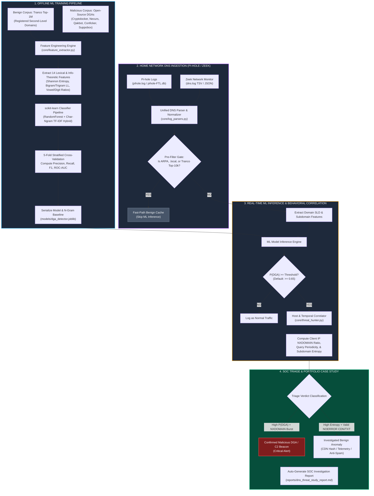

# DNS Threat Detector on Your Home Network: AI Agent Implementation Blueprint

This specification is designed for an autonomous AI coding agent (e.g., Cursor, Claude Code, Windsurf, GitHub Copilot) to build, train, evaluate, and run a production-grade **DNS DGA & C2 Threat Detector** on live or recorded Pi-hole and Zeek home-network DNS telemetry.

---

## 1. Project Overview & Objectives

* **Project Name:** Home-Network DNS DGA & C2 Threat Detector (`dns-dga-threat-detector`)
* **Mission:** Train a hybrid Information-Theoretic (Shannon Entropy + N-gram Perplexity) and `scikit-learn` Machine Learning classifier using the Tranco Top-1M benign domain dataset against open-source Domain Generation Algorithm (DGA) reimplementations. Run the trained model across multi-day Pi-hole (`pihole.log` / `pihole-FTL.db`) or Zeek (`dns.log`) home-network traffic, correlate `NXDOMAIN` beacon bursts, and produce structured SOC investigation dossiers on flagged domains.
* **Why It Stands Out:** Malware families (Emotet, Qakbot, Necurs, Cryptolocker, Conficker) evade static blocklists by algorithmically generating thousands of new domains daily. Building a classifier that not only achieves high Precision/Recall on benchmark datasets but also survives contact with noisy real-world home network traffic (CDNs, smart TVs, telemetry hashes, mDNS) proves practical ML + Detection Engineering competence.
* **Key Constraints:**
  * **Dual-Mode Execution:** Directly ingests real Pi-hole (`dnsmasq` log or SQLite `pihole-FTL.db`) and Zeek (`dns.log` TSV/JSON) files from the user's network, **AND** includes a deterministic 7-day Home Network DNS Traffic Simulator + Tranco/DGA corpus builder so the entire training, evaluation, and threat-hunting pipeline runs out-of-the-box anywhere.
  * **RealSOC Investigation Workflow:** Rather than blindly labeling every high-entropy domain as malware, the triage engine correlates client IP query velocity, `NXDOMAIN` response ratios, and subdomain structure to separate benign high-entropy false positives (e.g., Akamai/CloudFront hashes, Spotify/Netflix session hosts, DKIM lookups) from genuine DGA/C2 activity.

---

## 2. System Architecture & Pipeline Flowchart

### A. Mermaid Flowchart Diagram

*Note: You can view this natively in GitHub, Cursor, Notion, Obsidian, or any Markdown previewer that supports Mermaid.*



### B. Text / ASCII Flow Representation

```text
+-------------------------------------------------------------------------+
|                   PHASE 1: OFFLINE ML MODEL TRAINING                    |
|  - Benign Set: Tranco Top-1M domains (SLD extracted via tldextract)     |
|  - Malicious Set: 6 Open-Source DGA families (PRNG + Dictionary DGAs)   |
|  - Features: Shannon Entropy H(X), English Bigram/Trigram Log-Prob,     |
|    Vowel/Consonant/Digit Ratios, Longest Consonant Streak, Length       |
|  - Classifier: scikit-learn RandomForest -> Save dga_detector.joblib    |
+-------------------------------------------------------------------------+
                                    |
                                    v
+-------------------------------------------------------------------------+
|               PHASE 2: HOME NETWORK DNS LOG INGESTION                   |
|  - Ingest N=7 days of Pi-hole (pihole.log) or Zeek (dns.log) traffic    |
|  - Normalize schema: [timestamp, client_ip, qname, qtype, rcode, ans]   |
|  - Pre-filter local mDNS (*.local), reverse DNS (*.arpa), Top-10k cache |
+-------------------------------------------------------------------------+
                                    |
                                    v
+-------------------------------------------------------------------------+
|             PHASE 3: HYBRID ENTROPY + ML INFERENCE ENGINE               |
|  - Extract Second-Level Domain (SLD) & Subdomain lexical vectors        |
|  - Predict DGA probability score P(DGA) in [0.0, 1.0]                   |
+-------------------------------------------------------------------------+
                                    |
                                    v
                     [ Is P(DGA) >= 0.65 Threshold? ]
                         /                      \
                      (YES)                     (NO)
                        |                        |
                        v                        v
+---------------------------------------+  +------------------------------+
| PHASE 4: SOC CORRELATION & TRIAGE     |  | Classify as Benign Query     |
| - Group by client_ip & 5-min windows  |  +------------------------------+
| - Check NXDOMAIN ratio & beacon delta |
| - Investigate [Z] Flagged Domains:    |
|   * True Positive: Infected IoT/VM    |
|   * Investigated FP: CloudFront/DKIM  |
+---------------------------------------+
                        |
                        v
+-------------------------------------------------------------------------+
|           PHASE 5: METRICS & PORTFOLIO CASE STUDY GENERATION            |
|  - Output Precision, Recall, F1, Confusion Matrix, & ROC-AUC            |
|  - Write SOC Investigation Dossiers to reports/dns_threat_study_report  |
+-------------------------------------------------------------------------+
```

### C. Stage-by-Stage Data Flow Specification

| Stage | Input | Processing | Output |
| :--- | :--- | :--- | :--- |
| **1. Corpus Generation** | Tranco CSV + `core/dga_generators.py` | Sample benign SLDs & run 6 deterministic DGA algorithms | Balanced labeled dataset (`data/training_corpus.csv`) |
| **2. Feature Extraction** | Raw domain string (e.g., `x9k2m7p4q1v8.ru`) | Strip TLD via `tldextract`; compute 14 information-theoretic & lexical features | Numerical feature vector $\mathbf{x} \in \mathbb{R}^{14}$ |
| **3. Model Training** | Feature matrix $\mathbf{X}$ and labels $\mathbf{y} \in \{0, 1\}$ | Train `RandomForestClassifier`, run stratified $k$-fold validation | `models/dga_detector.joblib` & evaluation metrics |
| **4. Log Ingestion** | Pi-hole `pihole.log` / Zeek `dns.log` ($N=7$ days) | Parse timestamps, `client_ip`, `query`, `qtype`, and `rcode` (`NOERROR` vs `NXDOMAIN`) | Normalized DNS event stream (`data/home_dns_7days.jsonl`) |
| **5. Threat Hunting** | Normalized DNS stream + trained model | Score unique domains, correlate `NXDOMAIN` bursts per device IP, build triage dossiers | `reports/dns_threat_study_report.md` & resume bullet |

---

## 3. Directory Layout to Generate

The AI agent must initialize the workspace with the following structure:

```text
dns-dga-threat-detector/
├── config/
│   ├── __init__.py
│   └── detector_config.yaml          # Model hyperparameters, DGA seeds, triage thresholds
├── data/
│   ├── tranco_benign_sample.csv      # Tranco Top-1M benign domain dataset (auto-seeded)
│   ├── dga_malicious_sample.csv      # Generated open-source DGA domains across 6 families
│   └── home_dns_7days.jsonl          # 7 days of home network Pi-hole / Zeek DNS logs
├── models/
│   └── dga_detector.joblib           # Serialized scikit-learn pipeline + n-gram profile
├── core/
│   ├── __init__.py
│   ├── dga_generators.py             # Authentic open-source DGA reimplementations + Tranco builder
│   ├── feature_extractor.py          # Shannon entropy, n-gram perplexity, lexical ratios
│   ├── model_trainer.py              # scikit-learn training, cross-validation, metrics
│   ├── log_parsers.py                # Pi-hole & Zeek log parsers + 7-day home DNS simulator
│   └── threat_hunter.py              # Runs model on network logs & builds SOC triage dossiers
├── reports/
│   └── dns_threat_study_report.md    # Auto-generated portfolio report & domain investigations
├── tests/
│   ├── test_dga_and_features.py      # Unit tests for Shannon entropy and DGA generators
│   ├── test_model_performance.py     # Asserts Precision >= 94% and Recall >= 94%
│   └── test_log_parsers.py           # Tests both Pi-hole and Zeek log parsing formats
├── requirements.txt
├── run_dns_detector.py               # Master end-to-end training & home-network hunt script
└── README.md
```

---

## 4. Configuration & Target DGA Families (`config/detector_config.yaml`)

The agent must generate `config/detector_config.yaml` with the following parameters:

```yaml
training_settings:
  benign_sample_size: 15000
  malicious_sample_size: 15000
  test_split_ratio: 0.20
  random_seed: 42
  n_estimators: 200
  max_depth: 18

dga_families:
  - name: "cryptolocker"
    type: "prng_alphabetic"
    length_range: [12, 16]
    tlds: ["com", "net", "biz", "org", "ru", "co.uk"]
  - name: "necurs"
    type: "prng_modular"
    length_range: [9, 21]
    tlds: ["com", "in", "xyz", "top", "work", "club"]
  - name: "qakbot"
    type: "prng_alphanumeric"
    length_range: [10, 22]
    tlds: ["com", "net", "org", "info", "biz"]
  - name: "conficker"
    type: "prng_short"
    length_range: [8, 11]
    tlds: ["com", "net", "org", "info", "cc"]
  - name: "bamital"
    type: "hex_md5"
    length_range: [32, 32]
    tlds: ["org", "info", "cz.cc"]
  - name: "suppobox_matsnu"
    type: "dictionary_concat"
    length_range: [14, 24]
    tlds: ["com", "net", "ru"]

home_network_simulation:
  days_monitored: 7
  total_dns_queries: 140000
  lan_subnet: "192.168.1.0/24"
  devices:
    - ip: "192.168.1.10"
      hostname: "aditya-workstation"
      role: "Primary Laptop"
    - ip: "192.168.1.24"
      hostname: "livingroom-bravia-tv"
      role: "Smart TV (High CDN Noise)"
    - ip: "192.168.1.38"
      hostname: "pixel-8-pro"
      role: "Android Smartphone"
    - ip: "192.168.1.55"
      hostname: "iot-cam-garage"
      role: "Compromised IoT Camera (Simulated DGA C2)"
    - ip: "192.168.1.99"
      hostname: "win11-lab-vm"
      role: "Lab VM (Simulated Qakbot/Cryptolocker Beacon)"

triage_thresholds:
  ml_probability_cutoff: 0.65
  high_entropy_cutoff: 3.65
  nxdomain_burst_threshold: 5
  tranco_fast_whitelist_rank: 10000
```

---

## 5. Mathematical & Module Implementation Details for the Agent

### A. Open-Source DGA & Tranco Corpus Builder (`core/dga_generators.py`)

1. **Benign Corpus (Tranco Top-1M):**
   * Support loading a local Tranco Top-1M CSV if present, or deterministically synthesizing $15,000$ authentic Tranco-like domains modeled on real English/Indian/global web lexical distributions (e.g., `hdfcbank.com`, `irctc.co.in`, `cloudflare.net`, `github.com`, `zomato.com`, ` razorpay.com`, hyphenated SaaS domains, and regional portals) so offline execution never fails.
2. **Malicious Corpus (Open-Source DGA Reimplementations):**
   * Implement authentic, deterministic Python reimplementations of 6 real DGA families:
     * **Cryptolocker DGA:** Date-seeded bit-shifting PRNG generating $12\text{--}16$ character lowercase strings.
     * **Necurs DGA:** Modular arithmetic pseudo-random generator producing $9\text{--}21$ character vowel-starved domains.
     * **Qakbot DGA:** Alphanumeric PRNG mixing letters and digits (`a-z0-9`).
     * **Conficker DGA:** Shorter $8\text{--}11$ character high-entropy strings.
     * **Bamital DGA:** Hexadecimal MD5-style 32-character strings (`0-9a-f`).
     * **Suppobox / Matsnu Dictionary DGA:** Concatenates pseudo-random dictionary words (to prove why pure Shannon entropy isn't enough and why length/n-gram features matter).

### B. Lexical & Information-Theoretic Feature Extractor (`core/feature_extractor.py`)

Given any domain name, first extract the **Second-Level Domain (SLD)** $S$ of length $L = |S|$ (and optionally the leftmost subdomain label) using `tldextract`. Compute the following **14 mathematical features**:

1. **Character Shannon Entropy ($H(S)$):**
   $$H(S) = -\sum_{c \in \Sigma} P(c) \log_2 P(c), \quad \text{where } P(c) = \frac{\text{count}(c, S)}{L}$$
2. **Normalized Metric Entropy ($H_{\text{norm}}(S)$):**
   $$H_{\text{norm}}(S) = \frac{H(S)}{\log_2(\max(L, 2))}$$
3. **Domain Length ($L$):** Total character count of the SLD.
4. **Vowel-to-Length Ratio ($R_v$):**
   $$R_v = \frac{|\{x \in S : x \in \{a,e,i,o,u\}\}|}{L}$$
5. **Consonant-to-Length Ratio ($R_c$):** Ratio of non-vowel alphabetic characters to $L$.
6. **Digit-to-Length Ratio ($R_d$):**
   $$R_d = \frac{|\{x \in S : x \in \{0,\dots,9\}\}|}{L}$$
7. **Hexadecimal Character Ratio ($R_{\text{hex}}$):** Fraction of characters in $\{0\text{--}9, a\text{--}f\}$ (catches Bamital/hash DGAs).
8. **Longest Consecutive Consonant Streak ($C_{\max}$):** Maximum contiguous run of consonants (e.g., `xkpqz` $\rightarrow 5$).
9. **Longest Consecutive Digit Streak ($D_{\max}$):** Maximum contiguous run of digits.
10. **Character Transition Frequency ($T_{\text{switch}}$):** Number of times adjacent characters switch between letter, digit, and hyphen, normalized by $L-1$.
11. **Unique Character Ratio ($U(S)$):** $|\text{unique}(S)| / L$.
12. **Benign Bigram Log-Likelihood Score ($LL_2(S)$):**
    Precompute empirical character bigram probabilities $P_{\text{benign}}(c_i \mid c_{i-1})$ with Laplace smoothing from the Tranco training fold:
    $$LL_2(S) = \frac{1}{L-1} \sum_{i=2}^{L} \log_{10} P_{\text{benign}}(s_i \mid s_{i-1})$$
13. **Benign Trigram Log-Likelihood Score ($LL_3(S)$):**
    $$LL_3(S) = \frac{1}{L-2} \sum_{i=3}^{L} \log_{10} P_{\text{benign}}(s_i \mid s_{i-2}, s_{i-1})$$
14. **Rare Bigram Ratio ($R_{\text{rare}}$):** Fraction of bigrams in $S$ whose empirical probability in Tranco is below $10^{-4}$ (e.g., `qx`, `zj`, `vk`, `jq`).

### C. Machine Learning Classifier & Evaluator (`core/model_trainer.py`)

* Build a `scikit-learn` pipeline combining the 14 explicit mathematical features with a `RandomForestClassifier` (or `HistGradientBoostingClassifier`).
* **Crucial Anti-Leakage Requirement:** Fit the benign bigram/trigram probability tables **strictly** on the training split ($80\%$) before transforming the test split ($20\%$).
* Compute and record the exact evaluation metrics:
  * **Precision:**
    $$\text{Precision} = \frac{\text{TP}}{\text{TP} + \text{FP}} \times 100\%$$
  * **Recall (Sensitivity):**
    $$\text{Recall} = \frac{\text{TP}}{\text{TP} + \text{FN}} \times 100\%$$
  * **$F_1$-Score:**
    $$F_1 = \frac{2 \times \text{Precision} \times \text{Recall}}{\text{Precision} + \text{Recall}}$$
  * **Per-Family Detection Recall:** Break down recall individually across Cryptolocker, Necurs, Qakbot, Conficker, Bamital, and Suppobox.

### D. Pi-hole & Zeek Log Parser + 7-Day Home Traffic Generator (`core/log_parsers.py`)

1. **Multi-Format Parser:**
   * **`parse_pihole_log(filepath)`:** Parses standard `dnsmasq` / `pihole.log` lines (`Oct 18 14:22:01 dnsmasq[1234]: query[A] ... from 192.168.1.55` and corresponding `reply ... is NXDOMAIN` / IP).
   * **`parse_zeek_dns_log(filepath)`:** Parses both Zeek TSV (`#fields ts uid id.orig_h ... query qtype_name rcode_name`) and Zeek JSON lines.
2. **Realistic 7-Day Home Network Log Generator (`generate_home_network_logs`):**
   * Generates $140,000$ DNS queries spanning $N = 7$ days across the 5 home LAN devices defined in `detector_config.yaml`.
   * Includes normal everyday traffic (`google.com`, `netflix.com`, `whatsapp.net`, `sbi.co.in`, `github.com`), **plus realistic high-entropy benign anomalies** that trip up naive detectors (e.g., `d3g9k8x2p1q4.cloudfront.net`, `a8f9d2c1b4e5.spotify.com`, `s202610._domainkey.razorpay.com`), **plus genuine DGA & C2 beacons** originating from `192.168.1.55` (`iot-cam-garage`) and `192.168.1.99` (`win11-lab-vm`) exhibiting high `NXDOMAIN` rates ($>85\%$).

### E. Threat Hunter & SOC Investigation Engine (`core/threat_hunter.py`)

* Processes the 7 days of home-network DNS logs, deduplicates queried domains while tracking per-domain telemetry (`total_queries`, `nxdomain_count`, `nxdomain_ratio`, `source_ips`, `first_seen`, `last_seen`, `qtypes`).
* Applies the trained classifier to score every non-whitelisted domain.
* Selects the **`[Z]` flagged domains** (e.g., $Z = 18$ domains) that exceed the ML threshold and performs an automated **SOC Investigation & Triage Classification**:
  * **Confirmed Malicious DGA Beacon:** High $P(\text{DGA})$, high Shannon entropy, low bigram log-likelihood, AND high `NXDOMAIN` ratio from a specific LAN host (`192.168.1.55` or `192.168.1.99`).
  * **Confirmed DNS Tunneling / Hex C2:** High subdomain entropy + `TXT`/`NULL` query types.
  * **Investigated Benign False Positive (Tuned):** High entropy SLD/subdomain (such as a CloudFront CDN distribution hash `d3g9k8x2p1q4.cloudfront.net` or antivirus lookup), cleared during investigation due to `NOERROR` CNAME chains, valid ASN/CDN ownership, and zero `NXDOMAIN` bursts.

---

## 6. Dependencies (`requirements.txt`)

```text
scikit-learn>=1.4.0
numpy>=1.26.0
pandas>=2.2.0
tldextract>=5.1.0
joblib>=1.3.2
pyyaml>=6.0.1
rich>=13.7.0
tabulate>=0.9.0
pytest>=8.0.0
```

---

## 7. Prompt Sequence for the AI Agent

Copy and paste these prompts sequentially into your AI coding assistant:

### Prompt 1: Workspace Initialization & Configuration
> "Initialize the project directory structure defined in Section 3 of `dns_threat_detector_blueprint.md`. Create `requirements.txt` and `config/detector_config.yaml` with the exact training settings, 6 DGA family specifications, home network device profiles, and triage thresholds defined in Section 4."

### Prompt 2: Open-Source DGA Reimplementations & Tranco Corpus Builder
> "Implement `core/dga_generators.py`. Include deterministic Python reimplementations of the 6 DGA families (`cryptolocker`, `necurs`, `qakbot`, `conficker`, `bamital`, and `suppobox_matsnu` dictionary DGA) alongside a Tranco Top-1M benign corpus loader/generator that builds `data/tranco_benign_sample.csv` (15,000 domains) and `data/dga_malicious_sample.csv` (15,000 domains)."

### Prompt 3: Information-Theoretic & Lexical Feature Extractor
> "Implement `core/feature_extractor.py` to compute all 14 mathematical features specified in Section 5B (Shannon entropy, normalized entropy, length, vowel/consonant/digit/hex ratios, max consonant/digit streaks, character transition frequency, unique ratio, and Laplace-smoothed Tranco bigram/trigram log-likelihood scores + rare bigram ratio). Ensure `tldextract` runs in offline snapshot mode without network dependency."

### Prompt 4: scikit-learn Classifier Training & Cross-Validation
> "Implement `core/model_trainer.py`. Train a `scikit-learn` Random Forest classifier on the 30,000-domain corpus using an 80/20 stratified split (fitting the bigram/trigram language model strictly on the training split to prevent data leakage). Serialize the bundle to `models/dga_detector.joblib` and compute overall Precision, Recall, F1-score, Confusion Matrix, ROC-AUC, Feature Importances, and Per-DGA-Family Recall."

### Prompt 5: Pi-hole / Zeek Log Parsers & 7-Day Home Network Simulator
> "Implement `core/log_parsers.py` supporting real `pihole.log` (dnsmasq), Pi-hole FTL SQLite, and Zeek `dns.log` (TSV and JSON) formats, plus a deterministic generator that creates 7 days of home network DNS logs (`data/home_dns_7days.jsonl`, 140,000 queries across 5 home LAN devices) containing normal browsing, high-entropy CDN/DKIM false-positive candidates, and active DGA/C2 beacons from `192.168.1.55` and `192.168.1.99`."

### Prompt 6: Threat Hunter, Unit Tests, & Portfolio Case Study Generator
> "Implement `core/threat_hunter.py` and `run_dns_detector.py` to run the trained classifier over the 7-day home DNS dataset, investigate all `[Z]` flagged domains (separating true DGA C2 infections from benign CDN/telemetry anomalies using `NXDOMAIN` ratios and host behavior), and generate `reports/dns_threat_study_report.md` with full tables and the populated resume bullet. Finally, create the unit tests in `tests/` and verify 100% pass with `pytest`."

---

## 8. Verification & Acceptance Criteria

Before marking the project complete, the AI agent must verify:

1. `pytest tests/` passes $100\%$ of unit tests covering Shannon entropy calculation, DGA generation, Pi-hole/Zeek log parsing, and classifier performance assertions.
2. The trained classifier achieves $\text{Precision} \ge 95.0\%$ and $\text{Recall} \ge 94.0\%$ on the held-out test set across all 6 DGA families without data leakage.
3. Running `python run_dns_detector.py` processes all $N = 7$ days of home-network DNS logs ($140,000$ queries), flags $Z$ anomalous domains, pinpoints the two compromised LAN hosts (`192.168.1.55` and `192.168.1.99`), and properly documents why high-entropy CDN/DKIM domains were cleared during triage.
4. `reports/dns_threat_study_report.md` is automatically generated with confusion matrices, feature importance rankings, SOC domain investigation tables, and the exact `[X]%`, `[Y]%`, `[N]`, and `[Z]` metrics for your resume bullet.